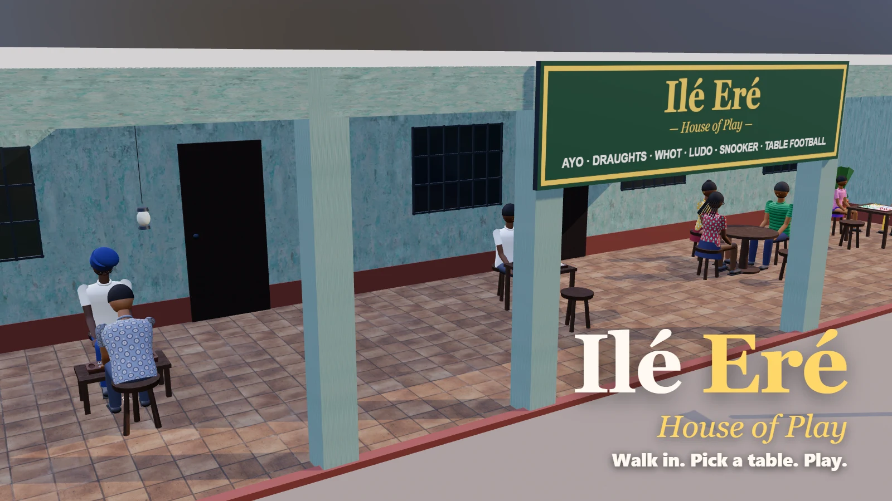

# Baba's Joint

A Lagos game house you walk into as your own start.ng character. Tables line the verandah and the courtyard: **Ayo** with Baba, **Draughts** with Tunde the barber, **Whot** with Iya Bisi and friends, **Ludo** with Kemi and Tobi, **Snooker** with Emeka and **Table football** with Chidi. Walk up to a table and sit down to play. A three.js game for [start.ng](https://start.ng).

**Every table is playable**, each with Easy, Normal and Hard opponents:

| Table | Who you play | Rules |
|---|---|---|
| Ayo | Baba | Ayò Olópón: captures on 2 or 3, first to 25 seeds (`src/ayo.js`) |
| Draughts | Tunde the barber | International 10×10: compulsory maximum capture, men capture backwards, flying kings (`src/draughts.js`) |
| Whot | Iya Bisi, Uncle Femi, Mama Ngozi | Nigerian Whot: Hold on, Pick two, Pick three, Suspension, General market, Whot calls (`src/whot.js`) |
| Ludo | Kemi and Tobi | One die, 6 to come out, captures, stars, blocks (`src/ludo.js`) |
| Snooker | Emeka | One frame on a bar-size table, with real ball physics, fouls and re-spotting (`src/snooker.js`) |
| Table football | Chidi | Four rods each (1-2-5-3), first to 5 goals (`src/foosball.js`) |

Each rules engine has its own tests in `tools/` (`node tools/<game>.test.mjs`). The computer players for Draughts and Snooker think in a background worker (`src/aiWorker.js`) so the table keeps moving.

The start.ng leaderboard ranks players by their total wins at the joint on Normal and Hard, with columns for Ayo, Whot, Draughts & Ludo, and Snooker & Football.

Walking: WASD or arrow keys (Shift to hurry), drag to look around, or tap the floor or a table to walk there. Next to a table, press E or tap the button to sit down.

## The Ayo table

Sit down with Baba for a game of **Ayo**, the Yoruba seed game.



## How to play

- The near row of six pits is yours. Each starts with 4 seeds.
- Pick one of your pits. Its seeds are sown one by one into the following pits, anticlockwise: along your row to the right, then back along Baba's row.
- If your last seed lands in one of Baba's pits and makes it **2 or 3**, you capture them, plus any pits just before it on Baba's side that also hold 2 or 3.
- A pit with 12 or more seeds goes all the way round and skips the pit it started from.
- You can't capture every seed Baba has in one move (the move captures nothing).
- If Baba's row is empty you must give him seeds if you can; if you can't, the game ends and you keep yours.
- First to **25** wins. After 60 moves without a capture, each player keeps the seeds on their side.

Baba plays at three strengths (Easy, Normal, Hard). Wins on Normal and Hard build your **win streak**, which goes on the start.ng leaderboard, with seeds captured as the tie-break.

Controls: click or tap one of your pits (or press 1–6). Drag to look around, scroll to zoom, M for sound.

- **Baba's lesson:** your first game starts with Baba walking you through it: your row, how sowing goes round, and (as soon as you have one) a glowing pit that captures. You can skip it, or replay it from the **?** sheet.
- **Move preview** (Easy and Normal): point at one of your pits, or tap it once on a phone, to see the pits its seeds pass through, where the last one lands, and what it would capture. Tap again to play.
- **Animation speed:** Normal, Fast or Very fast, in the menu.
- **Baba is alive:** he blinks, watches the seeds, glances up at you while you think, strokes his chin over a hard move, laughs at a big capture, looks surprised at yours, and claps when you beat him. After each game he leaves you a Yoruba proverb with its meaning.
- **The verandah:** the time of day follows your clock (afternoon, golden evening, or night by lantern with crickets). Chickens potter about, okadas pass on the road, neighbours greet Baba, and his radio plays highlife (click the radio to switch it off).
- **Your record:** wins, losses and draws against each level of Baba, your best streak and your biggest win, kept in your browser.

Try a time of day locally with `?time=day`, `?time=evening` or `?time=night`.

## Your start.ng character

The game asks start.ng who's playing (`startng:whoami` through `https://start.ng/connect`) and builds your 3D character from your start.ng `style`: body shape, top, trousers or skirt, skin, hair colour, hair (short, afro, braids, bun, ponytail, dreads, bald), hat (cap, beanie, top hat, crown) and accessory (glasses, earrings, beard, scarf, backpack). Change your character on start.ng and come back to the tab, and it changes at the board too. Guests play as start.ng's guest look.

## Run it locally

Static files, no build step. three.js r170 is in `vendor/`.

```sh
python -m http.server 8000
# open http://localhost:8000
```

Locally there's no start.ng player, so you play as a guest; add `?style={"hair":"braids","hat":"crown",...}` to try a look (ignored on start.ng). Rule tests: `node tools/ayo.test.mjs`.

## Files

- `src/ayo.js`: the rules and Baba's play (alpha-beta search), with no graphics
- `src/scene.js`: the verandah, lighting, board, pits and seeds
- `src/character.js`: builds a seated character from a start.ng `style`
- `src/main.js`: turns, animation, camera, input, start.ng scores
- `src/startng.js`: talks to start.ng's connect page
- `src/sound.js`: synthesized sounds (seeds on wood, captures, birds)

## Credits

Sky lighting (`balcony`) and wood, tile and plaster textures from [Poly Haven](https://polyhaven.com), CC0. The textures are re-encoded as WebP and the sky halved to 512×256 to keep the whole game around 2.3 MB.

## Sound credits

Recorded sounds and music live in `assets/audio/` (full per-file list in `assets/audio/CREDITS.md`). Everything is CC0 except:

- "Imela" (album "Ekene") and "Egwu Nwa" (album "Egwu Nwa") by Ugo Mbaise, from the Free Music Archive (https://freemusicarchive.org/music/ugo-mbaise/), licensed under CC BY 4.0 (https://creativecommons.org/licenses/by/4.0/). Excerpted, faded and level-adjusted.
- "singledrop1.aif", "singledrop2.aif", "singledrop3.aif" and "clatter1.aif" by jaybatzner on Freesound (https://freesound.org/people/jaybatzner/), licensed under CC BY 4.0. Trimmed, normalised and re-encoded.

The voices are made up on the fly (a "babble" that follows each line's vowels), not recordings.
